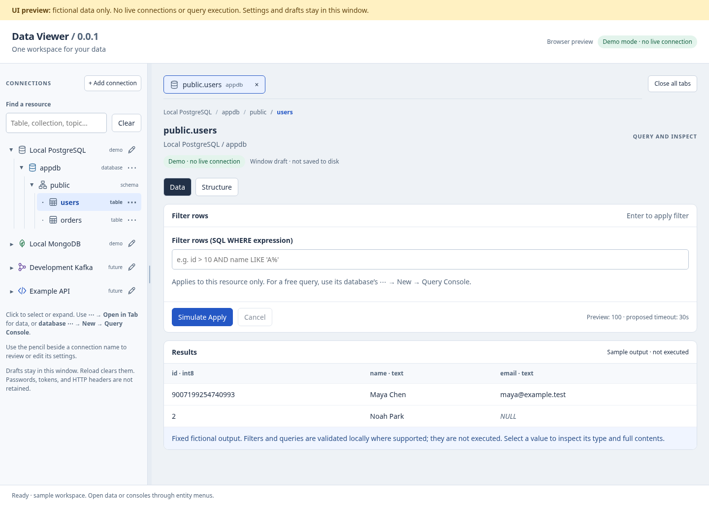

# Data Viewer

A planned desktop workspace for browsing PostgreSQL and MongoDB, built as a
personal project to learn Go.

The first release, `0.0.1`, targets December 31, 2026. It will focus on connecting
to databases, browsing their structure, retrieving data, and basic autocomplete.
The repository now includes a **Go/Wails shell and React/TypeScript UI preview**.
Database/tool operations still use fictional data. The backend is initialized
with a metadata bridge only, ready for the developer's Go implementation.

```sh
npm --prefix frontend ci
npm --prefix frontend run dev
```

See [development setup, desktop builds, and checks](docs/development.md) for Wails
prerequisites and the complete workflow.

## Implementation documentation

- [Release plan and weekly milestones](docs/release-0.0.1-plan.md)
- [Development setup and source map](docs/development.md)
- [Architecture and feature design](docs/architecture.md)
- [Domain model, identities, and workspace lifecycle](docs/domain-model.md)
- [Beginner implementation guide](docs/implementation-guide.md)
- [Feature inventory and ownership](docs/features.md)
- [Integration plugin design](docs/plugin-design.md)
- [UI/UX guide and wireframes](docs/ui-ux-guide.md)
- [UI research, sources, and design decisions](docs/ui-research.md)
- [Interactive UI prototype](docs/ui-prototype.html) — open locally in a browser;
  searchable integration setup, Kafka Consume/Publish, and HTTP future workspaces; fictional data
  only, no application backend
- [Backend/frontend handoff](docs/frontend-handoff.md)
- [Codex PR review guide](docs/pr-review-guide.md)
- [Repository context for AI reviewers](AGENTS.md)

The developer's main learning focus is implementing the Go backend. Frontend
work can proceed separately using the UI specification and agreed response
fixtures. The HTML prototype remains a design reference; the React UI implements
its interactions with mock services, not release database capabilities.
It includes resource search, per-resource window drafts, breadcrumbs, value
inspection, a resizable explorer, and Kafka copy-to-publish drafts. All tool
operations still use fictional data and make no network requests.
Table/collection views use text filters. Row clicks select/expand only; use each
data entity's right-side ⋯ → Open in Tab. Parent/group rows have no menus or
overview pages. Database ⋯ → New → Query Console directly opens a
separate database-bound editor tab (SQL or MongoDB command JSON). Entity action
menus can grow later; index inspection is currently a disabled planned action.
The last tab can close. Close all tabs leaves an empty workspace with the explorer
and Add connection still available.
Use the pencil beside a connection name to review or edit its saved settings
(PostgreSQL, MongoDB, Kafka, or HTTP). Demo edits stay in this window; passwords
are not retained, and saving does not reconnect or retarget existing tabs.

The shell uses Go, Wails, React/TypeScript, and CodeMirror 6. `pgx` and the official
MongoDB Go driver remain planned; Kafka and HTTP are future backend extensions.


