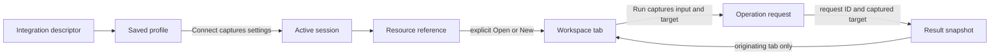

# Domain model and workspace state

This is the proposed production model behind the [current UI](ui-ux-guide.md),
not code already present in the repository. Start with the PostgreSQL slice and
add the other types when their behavior is implemented. The HTML prototype uses
simplified fixture IDs and window memory; it does not implement these services.

## Identities and ownership

Use opaque IDs as strings at the Wails boundary. Display names and tree labels
are never lookup keys. Two profiles can point to the same server, and two
consoles can target the same database without sharing execution state.

| Model | Identity and important fields | Owner and lifetime |
| --- | --- | --- |
| IntegrationDescriptor | Adapter ID, name, category, icon key, capabilities, availability, trusted form reference | Built-in registry; application lifetime |
| ConnectionProfile | Profile ID, adapter ID, display name, typed non-secret settings, config revision | Go profile store; persists across restarts |
| RuntimeCredentials | Password or parsed URI credentials needed for Test/Connect | Form memory until submission, then Go attempt/session memory; never profile output |
| ActiveSession | Session ID (bridge `connectionId`), profile ID, captured config revision/settings, adapter handle, lifecycle state | Go connection manager; successful Connect until Disconnect/shutdown |
| ResourceRef | Session ID and structured database/schema/resource kind/name | Go metadata/query contracts; valid for that session |
| ExplorerNode | Node ID, parent ID, ResourceRef if executable, label, child-loading state | Frontend tree; metadata cache scoped to session and path |
| WorkspaceTab | Tab ID, view kind, captured target, draft, latest request ID, run state, result | Frontend workspace; explicit open until close |
| Operation | Request ID, session/target, operation kind, context/cancel, effective bounds | Go request registry; accepted start until terminal cleanup |
| ResultSnapshot | Request/session/target, status, timing, truncation, typed payload | Frontend originating tab; replaced by that tab's next result or close |

A saved profile can have zero or more sessions. For the first UI, offer one
current session per profile; the model must still distinguish an old session
from a later reconnect. A profile without a session can be edited but cannot run
database operations. HTTP later uses profile/request identity without requiring
a persistent database-style session.



Arrows describe references and actions, not Go package dependencies. Frontend
tabs never own or receive driver handles.

## Profiles, settings, and sessions

Use concrete settings structs per adapter. A discriminator selects the matching
settings type; reject mismatched adapter/settings combinations. Do not persist
an unrestricted `map[string]any` copied from a form or driver URI.

| Adapter | Saved settings | Runtime-only values |
| --- | --- | --- |
| PostgreSQL | Host, port, initial database, username, supported TLS preferences | Password; any secret key material |
| MongoDB | Parsed hosts/SRV mode, database, username if supported, approved non-secret auth/TLS/replica-set options | Password, credential-bearing raw URI, secret auth properties |
| Kafka (future) | Brokers, security protocol, SASL mechanism/username, supported TLS preferences | SASL password and secret key material |
| HTTP (future) | Base URL validated without embedded credentials or secret query parameters | Tokens, authorization headers and other secret request values |

Parse and validate settings in Go. For MongoDB, use driver-supported parsing and
an explicit serialization policy; the prototype's small URI allowlist is not a
production parser. Reconstruct an editable form from saved non-secret settings,
with password fields blank. Do not log the submitted config on validation errors.

Profile transitions:

1. **Add:** choose an adapter from the catalog; edit a local form draft. Save
   creates a stable profile ID. Adding it does not open a tab or create a session.
2. **Edit:** the root pencil loads that profile's settings; adapter ID is fixed.
   Cancel/Escape discards the form draft. Save validates and atomically replaces
   only the non-secret profile. It returns the saved profile for labels/forms.
3. **Rename:** keep profile/session/resource/tab IDs intact; update display labels.
   A label change does not require reconnecting.
4. **Change endpoint/settings:** increment the config revision when connection
   settings change. Existing sessions retain their captured settings/revision.
   Show that settings apply on the next connection; do not rebuild their resource
   tree or change any tab's target behind the user.
5. **Test:** use the current form plus supplied credentials for a bounded attempt;
   close the temporary client on every outcome. It does not implicitly save.
6. **Connect:** validate and capture one config/credential snapshot, ping, and
   publish a fresh session ID only on success. A failed attempt releases partial
   clients. A combined Save and connect must report the two outcomes separately.

Session states are connecting → connected → disconnecting → closed; a failed
attempt returns a safe error without registering a usable connected session.
The connection manager synchronizes state changes and refuses new work once
disconnecting begins. Do not hold its mutex during network I/O.

Disconnect cancels session-owned operations, closes clients/pools, and invalidates
metadata. Keep existing tab drafts/results visible with a disconnected status,
disable Run, and label results with their original source. A reconnect produces
a new session ID; an explicit new/open action can create tabs for that session.
Automatic rebinding and session restoration are outside the first release.

## Resource identity and explorer state

Keep database, schema, and entity name as separate fields. For example, a table
named `order.items` is one identifier, not a path split at a dot. A representative
backend reference is:

```go
// Proposed DTO; validation is required, not provided by this sketch.
type ResourceRef struct {
    ConnectionID string // Active session ID, not profile ID.
    Kind         string // database, table, collection; validate per adapter.
    Database     string
    Schema       string // PostgreSQL only; empty for MongoDB.
    Name         string // Empty for a database reference.
}
```

Create opaque node IDs or a collision-safe encoding of the structured identity;
do not concatenate unescaped labels. A grouping folder has no executable target.

| Explorer level | Children | Explicit actions |
| --- | --- | --- |
| Connection/profile root | Databases, or a future tool's grouping folders | Direct Edit connection pencil; no action menu or overview |
| PostgreSQL database | Schemas | ⋯ → New → Query Console |
| PostgreSQL schema | Tables | No action menu or overview |
| MongoDB database | Collections | ⋯ → New → Query Console when command capability is available |
| Table/collection | Optional future children | ⋯ → Open in Tab; index inspection remains planned |
| Kafka Topics / HTTP Requests folders (future) | Topics/requests | No action menu or overview |
| Topic/request (future) | None initially | ⋯ → Open in Tab |

Clicking a row changes explorer selection/expansion only. Track `selectedNodeId`
separately from `activeTabId`. Search filters loaded nodes and retains ancestors;
neither search nor expansion changes an execution target. Fetch children lazily,
with per-node unloaded/loading/loaded/error state. Match response IDs and session
identity before replacing a branch. Empty and failed loads are different states.

PostgreSQL needs a pool per connected database, even if the UI groups databases
under one profile. Begin with the configured database; do not imply a pool can
switch database using a schema change. Opening another database later needs an
explicit database-session/pool path. MongoDB can address several authorized
databases through one client, with the database captured on each operation.

## Tabs and drafts

Resource tabs deduplicate by session ID + full resource identity + view kind;
Open in Tab activates an existing match. New → Query Console always creates a
new tab/console ID bound to the selected database. A console is not a database
overview. SQL and MongoDB command JSON use separate view kinds and capabilities.

The frontend needs a small workspace store: ordered tabs, active tab ID (nullable),
and a separate explorer selection. A tab captures:

- Target: session ID, database and optional schema/entity; never inferred from
  whichever explorer row is selected when Run is pressed.
- Draft: the resource filter/Find inputs or free-query text and selected view.
- Run state: idle, starting, running, cancel requested, or terminal outcome, plus
  latest request ID. Only one active operation per tab initially.
- Result snapshot: success/empty/error/canceled/timed-out data from that request,
  including its original target. A previous result may stay visible while running
  if clearly labeled as previous output.

Resource drafts can survive close/reopen in window memory, scoped to the same
session/resource. Console drafts/results are discarded on close in the current
design. Explicit password/token fields and raw HTTP headers never enter the draft
store. Query/filter/body text can also contain sensitive values: window drafts
are not redacted or safe to persist automatically. Reload/restart clears drafts;
persistent history is a separate stretch feature.

The last tab and all tabs can close. Closing removes the tab first, requests
cancellation of its work, and drops later output addressed to it. Clear console
drafts/results; release result payloads for closed resource tabs. Close all applies
this to every tab, sets active tab to null, and shows the empty workspace. It
does not disconnect profiles or disable the explorer, menus, or Add connection.

## Operations and results

At Run, copy the tab's target, inputs, and effective limits into an immutable
request. UI edits made afterward affect the next request only. A request ID is
unique per run; do not use the tab ID as a request ID.

Register cancellation before acknowledging start. The UI installs its lifecycle
listener before invoking the bridge, then enables Cancel only after the matching
start acknowledgement/event. Go checks session state and capabilities, validates
inputs, applies deadlines/output caps, and removes request entries on every exit.
Cancellation acknowledgement means requested; terminal completion means cleanup
finished. Keep terminal outcomes separate from a mere cancel-button click.
If a tab closes while its request is still starting, retain a small pending-start
record outside the tab and send Cancel as soon as registration is acknowledged.
Discard its output and remove that record on terminal completion. Do not cancel
an unregistered ID, forget it, and leave the subsequently started request running.
At the backend, serialize request admission with session closing so disconnect
cannot miss a newly registered operation.

Accept an arriving result only if the originating tab still exists, its latest
request ID matches, and its captured session/target still matches. An inactive
tab can receive its own result. Switching tabs or selecting another tree row
must not discard valid database results. A closed tab or disconnected session
cannot be resurrected by late success. On disconnect, resolve pending operations
as canceled/connection closed without replacing retained output with stale data.

Results share an envelope (request/session/target, status, elapsed time, count,
truncation and safe error), but retain capability-specific payloads: ordered SQL
columns/typed cells, canonical Extended JSON documents, and later Kafka records
or HTTP responses. Result detail/copy reads this snapshot, not the edited draft.
See [serialization and errors](frontend-handoff.md#serialization-example).

## Capability boundaries and implementation checks

The registry describes available adapters; saved profiles and tree menus never
grant capabilities. Validate every operation in Go against the active session.
Keep PreviewTable, ExecuteSQL, FindDocuments, and a future ExecuteMongoCommand
separate. A MongoDB command console must have a defined allowed command set,
per-command result limits, and cancellation before its action becomes enabled.
It must never evaluate mongosh/JavaScript or accept arbitrary commands merely
because the prototype accepts object-shaped JSON.

Kafka later has independent consume and publish requests with bounded stream
buffers, explicit delivery outcomes, and string-encoded offsets. HTTP later
captures the effective method/URL and response metadata; saving a base URL neither
sends a request nor changes a completed result's source.

Verify these invariants as their implementations land:

| Scenario | Required outcome |
| --- | --- |
| Save a different host while SQL is running | Profile changes; in-flight request and tab stay on their captured session |
| Rename one of two similar profiles | Only that profile's labels change; IDs and other profile's state stay intact |
| Open two consoles in one database | Distinct tab/request IDs and independent drafts, results and Cancel |
| Select a MongoDB row while a SQL tab is active | Explorer selection changes; SQL tab target stays unchanged |
| Close all during two runs | Empty workspace; cancel each operation; late output opens no tabs |
| Reconnect after disconnect | Fresh session ID; old tabs cannot execute against it implicitly |
| Load a malformed/credential-bearing profile | Reject or safely parse before storage; never echo raw secrets |
| Fail metadata refresh | Show branch error; preserve valid cached metadata with stale status |

Use focused Go tests for profile serialization, request/session lifecycle and
typed conversion, real-service tests for driver behavior, and UI checks for tab
and explorer interactions. The [implementation guide](implementation-guide.md)
orders this work without requiring all abstractions on day one.
